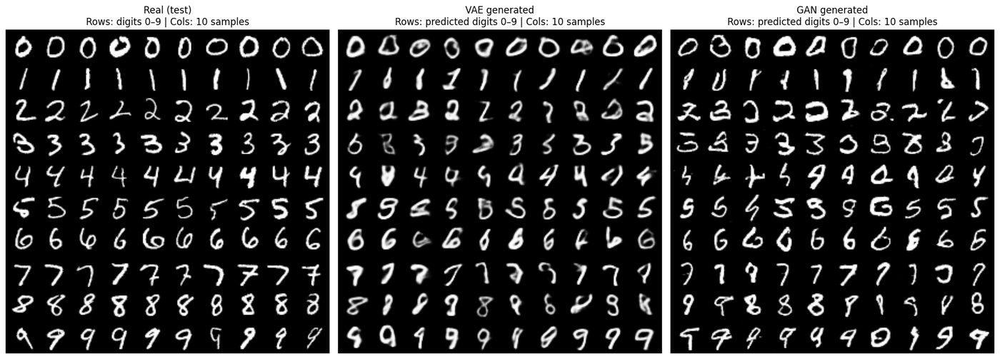
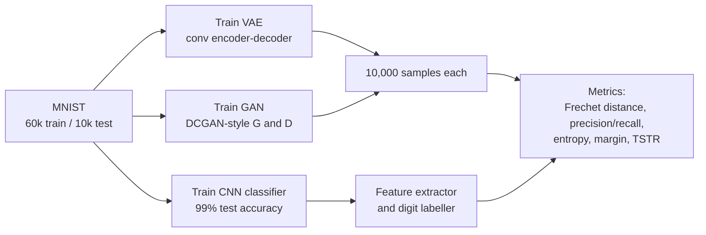
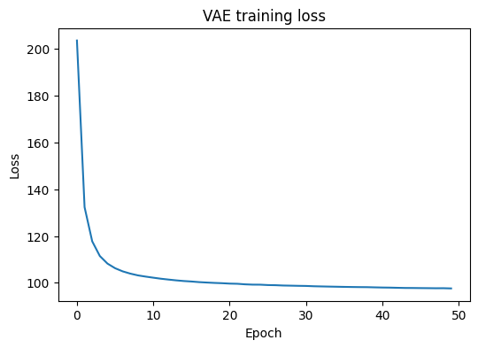
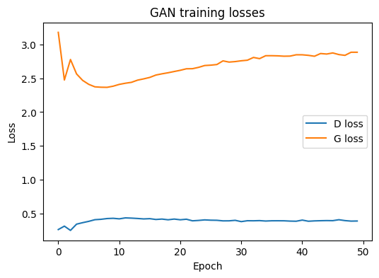
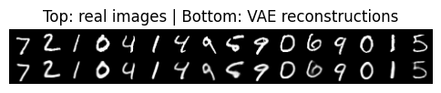

# VAE vs. GAN: Which Generates Better Images?

A controlled comparison of a **Variational Autoencoder** and a **Generative Adversarial Network** for generating handwritten digits (MNIST), evaluated with six complementary quantitative metrics rather than visual inspection alone.



*Real test digits (left), VAE samples (middle) and GAN samples (right), grouped by the digit an independent classifier recognises.*

## Highlights

- **Fair comparison:** both models built from scratch in PyTorch with a similar size (about 505K vs. 478K parameters), the same 32-dimensional latent space, data and training length (50 epochs).
- **Six evaluation metrics:** Fréchet distance, k-NN precision and recall, label diversity, classifier confidence, and train-on-synthetic / test-on-real (TSTR) accuracy.
- **Result:** the GAN's samples are much closer to the real data distribution (**Fréchet distance 50.4 vs. 138.6**), while the VAE's samples are slightly more useful as synthetic training data (**TSTR accuracy 95.4% vs. 94.2%**).

## Research question

*Is a GAN or a VAE better at producing realistic and diverse digit images from MNIST?*

"Better" is not one number, so the project measures four aspects: **realism** (how close samples are to real data), **diversity** (whether all digits are covered), **clarity** (whether digits are unambiguous) and **utility** (whether samples can train a useful model).

## Approach



| | VAE | GAN |
|---|---|---|
| Architecture | Conv encoder (2 layers) → μ, log σ² → transposed-conv decoder | Generator: linear → 2 transposed-conv layers + BatchNorm. Discriminator: 2 conv layers + LeakyReLU |
| Loss | Binary cross-entropy reconstruction + KL divergence | Standard adversarial loss (BCE with logits) |
| Optimiser | Adam, lr 1e-3 | Adam, lr 2e-4, β₁ = 0.5 |
| Parameters | 505,249 | 478,082 (G 339,265 + D 138,817) |

A separate CNN classifier (**99.0% test accuracy**) is trained on real MNIST. It provides the feature space for distribution metrics and labels the generated digits.

## Results

10,000 generated samples per model, compared against the real MNIST test set.

| Metric | What it measures | VAE | GAN |
|---|---|---:|---:|
| Fréchet distance ↓ | Realism: distance between real and generated feature distributions | 138.61 | **50.38** |
| k-NN precision ↑ | Realism: share of samples that fall within the real data manifold | **0.435** | 0.337 |
| k-NN recall ↑ | Coverage: share of real data covered by samples | 0.572 | **0.594** |
| Label entropy ↑ (max 2.303) | Diversity: balance across the 10 digits | 2.258 | **2.290** |
| Confidence margin ↑ | Clarity: classifier's top-1 minus top-2 probability (mean) | 0.780 | **0.834** |
| TSTR accuracy ↑ | Utility: classifier trained only on generated data, tested on real digits | **95.37%** | 94.22% |

**Training behaviour**

| VAE loss | GAN losses |
|---|---|
|  |  |

VAE reconstructions (top: real, bottom: reconstructed):



## Conclusions

- **The GAN wins on realism, coverage, diversity and clarity.** Its samples are sharper and much closer to the real distribution, and its digit distribution is more balanced. The VAE over-produces some digits (such as 3) and under-produces others (such as 0).
- **The VAE wins on precision and synthetic-data utility.** Its samples are blurrier and more "average", which places them inside the real manifold more often and makes them slightly better training data.
- **Overall, the GAN is the better generator for this task**, and the comparison shows why generative models should be judged with several metrics: a single score would have hidden these trade-offs.

## Repository structure

```
vae-vs-gan-image-generation/
├── notebooks/
│   └── vae_vs_gan_mnist.ipynb   # models, training, evaluation and figures
├── figures/                     # figures used in this README
├── docs/
│   └── report_summary.md        # summary of the study and findings
└── requirements.txt
```

## How to run

```bash
pip install -r requirements.txt
jupyter notebook notebooks/vae_vs_gan_mnist.ipynb
```

MNIST is downloaded automatically by `torchvision`. A GPU is recommended (the notebook was run on Google Colab). Random seeds are fixed for reproducibility.

## Project context

Generative AI empirical study, MSc Data Science, University of Naples Federico II (June 2026). A summary of the study is in [`docs/report_summary.md`](docs/report_summary.md).
